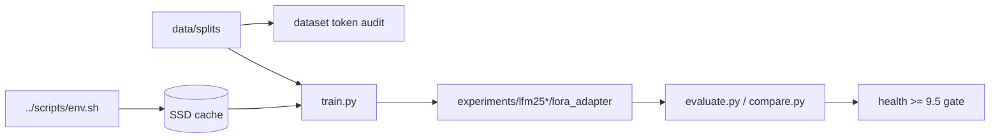

# Design — LFM2 Track

LFM2.5 training is optimized for low memory and fast local iteration. Retrieval work such as LFM2-ColBERT should use a separate contrastive/retrieval plan rather than chat SFT.
